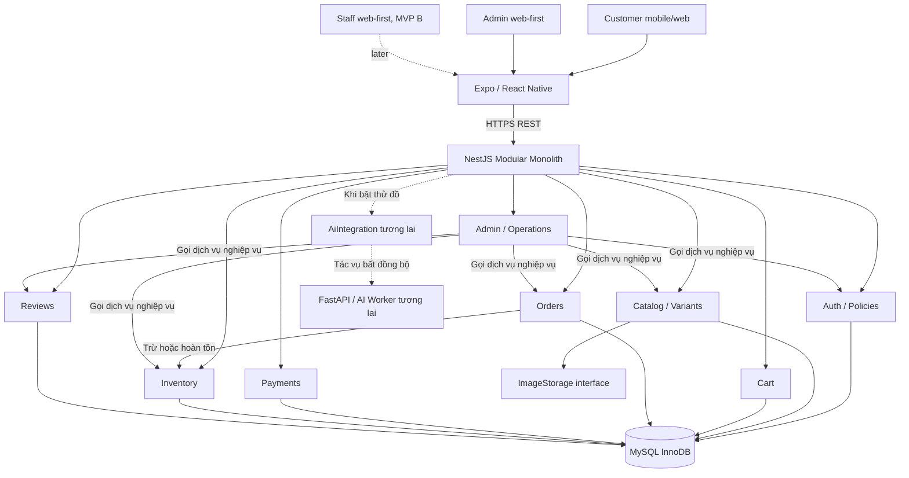

# Architecture v1 — Modular monolith và điểm tích hợp AI

**Trạng thái APPROVED — M1-01 đã nghiệm thu ngày 2026-11-20.** Thiết kế theo [PRD v1](01-PRD.md) và [ADR-0001](adr/0001-stack.md). Stack gồm Expo, NestJS và MySQL InnoDB, ưu tiên chạy local với ngân sách 0 đồng.



## Triển khai MVP A
- Một NestJS backend **modular monolith**. Không Seller service, Shop table, split orders, gateway chuyên dụng, Redis/Kafka/Kubernetes lúc đầu.
- Client Expo dùng TypeScript, điều hướng theo Customer/Admin; quản trị Web ưu tiên để giảm công việc. Staff UI thêm ở MVP B.
- REST `/api/v1`, DTO validation, Nest guards/policies, OpenAPI khi task tương ứng.
- MySQL InnoDB, migrations phiên bản và seed giả. Storage thông qua interface: local filesystem dev, lên object storage khi cần (không lưu ảnh binary trong MySQL).
- Mobile/web client không truy cập DB hoặc gọi AI worker bằng token nội bộ.

## Modules và trách nhiệm

Các module nghiệp vụ cùng chạy trong một ứng dụng NestJS. Mỗi module chịu trách nhiệm cho thay đổi dữ liệu của nghiệp vụ mình và cung cấp thao tác cho module khác gọi qua service. Một MySQL dùng chung cho phép checkout phối hợp nhiều module trong một giao dịch.

| Module | Nhiệm vụ |
|---|---|
| Auth / Users | Register Customer, login, auth, token/session, role/permissions, profile/addresses |
| Catalog | Categories, products, variants, images, filters, visibility |
| Cart | Cart state/items, quantity, server-side price revalidation |
| Orders | Điều phối giao dịch checkout, lưu snapshot đơn và dòng hàng, quản lý trạng thái, lịch sử và hủy đơn. Bảo đảm gửi lặp cùng yêu cầu và key chỉ tạo một đơn. |
| Inventory | Kiểm tra và cập nhật tồn theo SKU, ghi biến động. Khi checkout hoặc hủy gọi Inventory, thao tác tồn tham gia giao dịch do Orders điều phối. |
| Payments | Quản lý trạng thái COD riêng với trạng thái đơn. MVP A chỉ dùng COD mô phỏng theo ADR-0004. Gateway mock/sandbox thuộc P1 và cần quyết định riêng. Nếu sandbox có callback, xác minh chữ ký và xử lý lặp an toàn. |
| Reviews | Verified-purchase review, staff reply later, admin moderation |
| Admin / Operations | Cung cấp thao tác quản trị theo quyền và gọi các service phụ trách catalog, đơn, tồn kho, đánh giá và tài khoản. Staff dùng lại các service này ở MVP B. Dashboard thuộc P1. |
| AiIntegration (tương lai) | Nhận yêu cầu thử đồ, kiểm tra quyền trên job và điều phối tác vụ bất đồng bộ khi tính năng được bật. |

## Ranh giới nghiệp vụ
- Checkout đi từ Expo qua NestJS tới Orders. Server tính giá và lưu snapshot. Orders điều phối một giao dịch MySQL cho tạo đơn, lưu dòng hàng và trừ tồn qua Inventory. Nếu một SKU thiếu tồn, toàn bộ thay đổi được hoàn tác.
- Hủy hợp lệ dùng một giao dịch để đổi trạng thái, hoàn tồn đúng một lần và ghi biến động tồn kho. Payments giữ trạng thái thanh toán riêng với trạng thái đơn. Thiết kế khóa, xử lý đồng thời và idempotency chi tiết thuộc M1-06.
- Review eligibility truy vết `order_items`, chỉ đúng người mua; Admin moderation audit.
- Authorization ở API + service; Staff permissions được định nghĩa từ MVP A (Admin uses same capabilities), chỉ mở role/UI ở MVP B.
- Không dùng cache cho tính tồn kho authoritative; Redis chỉ thêm khi profiling/AI queue chứng minh nhu cầu.

## Điểm tích hợp AI thử đồ

- `TRYON_ENABLED=false` theo mặc định. Checkout và các module nghiệp vụ cửa hàng không gọi hoặc phụ thuộc vào AiIntegration hay FastAPI. Backend cửa hàng có thể chạy khi FastAPI chưa được triển khai.
- Khi tính năng được bật, Expo gửi yêu cầu và đọc trạng thái job qua NestJS. AiIntegration xác thực quyền trên ảnh và job, rồi chuyển tác vụ bất đồng bộ tới FastAPI. FastAPI xử lý ảnh đã được cấp quyền và không truy cập trực tiếp MySQL của cửa hàng.
- Lỗi hoặc timeout của AI chỉ ảnh hưởng luồng thử đồ. Colab phục vụ nghiên cứu mô hình. Chi tiết job, quyền ảnh và vòng đời tích hợp nằm trong [AI handoff](07-AI_HANDOFF.md).

## API outline (chưa frozen)
- `POST /api/v1/auth/register|login|logout`; `GET /api/v1/me`, `GET/POST/PATCH /api/v1/me/addresses`. Đề xuất cũ `/auth/refresh` được thay bằng đăng nhập lại khi phiên hết hạn theo [ADR-0003](adr/0003-auth-session.md) (đã nghiệm thu). Contract chi tiết thuộc M1-08.
- `GET /api/v1/categories|products|products/:id`, `GET /api/v1/products/:id/reviews`.
- `GET/POST/PATCH/DELETE /api/v1/cart/items` (verb và path cụ thể cần review).
- `POST /api/v1/orders`, `GET /api/v1/orders/me`, `GET /api/v1/orders/:id`, `POST /api/v1/orders/:id/cancel`.
- `POST /api/v1/orders/:id/reviews` hoặc `/reviews` (chọn một trong API contract).
- `/api/v1/admin/products|inventory|orders|reviews|users` (MVP A).
- `/api/v1/staff/orders|inventory|products` (MVP B), có thể reuse handlers theo permissions không copy business logic.
- `/api/v1/payments/...` mock/sandbox callback cần signature verification khi provider được chọn.
- `POST /api/v1/tryon/jobs`, `GET /api/v1/tryon/jobs/:id` (**future**, default off).

## Quy trình tăng quy mô (không làm ở MVP)
Index + EXPLAIN, cursor/page pagination, ảnh tối ưu, client cache → load testing → bổ sung connection pooling, cache/CDN, stateless replicas; AI queue + GPU worker scale riêng. Thêm dependency khi bottleneck được đo, không dựa giả định framework luôn nhanh.

## Repository đề xuất (chưa scaffold)
```text
fashion-store/
  apps/mobile/          # Expo Android/Web (+ iOS code)
  apps/api/             # NestJS
  services/ai/          # future FastAPI; có thể để trống đến AI milestone
  docs/ tracking/ templates/
  AGENTS.md README.md
  docker-compose.yml    # sau khi được duyệt
```

## Quyết định mở
ORM đã chốt trong [ADR-0002](adr/0002-orm.md), chính sách phiên trong [ADR-0003](adr/0003-auth-session.md), ảnh local và COD mô phỏng trong [ADR-0004](adr/0004-image-storage-and-payment.md). Quyền Staff theo [RBAC v1](06-RBAC.md). Contract upload, gateway P1 và phương thức triển khai còn chờ quyết định tương ứng.
