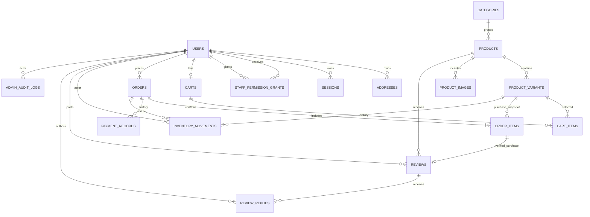

# DATA_MODEL v1 — MySQL InnoDB

**Trạng thái APPROVED — M1-05 đã nghiệm thu ngày 2026-11-20.**

**Chưa chạy schema/migration.** Thiết kế cho **một cửa hàng**; không dùng `shops`, `seller_accounts`, `shop_orders`, `seller_payouts`. Tiền dùng `DECIMAL(12,2)`, không dùng float.

## Danh sách bảng theo mốc
| Bảng | Trường tối thiểu gợi ý | Constraint / lý do |
|---|---|---|
| `users` | id,email,password_hash,role,status,created_at | email UNIQUE, role managed server; Staff active MVP B |
| `sessions` | id,user_id,token_hash,created_at,expires_at,last_seen_at,revoked_at | UNIQUE(token_hash); revoked_at nullable |
| `staff_permission_grants` (MVP B) | id,staff_user_id,permission_key,granted_by_user_id,granted_at | UNIQUE(staff_user_id,permission_key); quyền hiện hành |
| `addresses` | id,user_id,name,phone,address_text,is_default | FK user, own only; order uses snapshot |
| `categories` | id,name,slug,status | UNIQUE(slug) |
| `products` | id,category_id,name,slug,description,status,created_at | FK category; UNIQUE slug |
| `product_variants` | id,product_id,sku,size,color,price,stock_quantity,status | UNIQUE(sku); stock>=0; DECIMAL |
| `product_images` | id,product_id,storage_key,alt_text,sort_order | file ref only |
| `carts` | id,user_id,updated_at | UNIQUE(user_id), một giỏ cho mỗi Customer ở luồng đăng nhập |
| `cart_items` | id,cart_id,variant_id,quantity | UNIQUE(cart_id,variant_id), quantity>0 |
| `orders` | id,user_id,status,subtotal,shipping_fee,total,address_snapshot,idempotency_key,request_fingerprint,created_at | tổng tính ở server, FK Customer, UNIQUE(user_id,idempotency_key) |
| `order_items` | id,order_id,variant_id,sku_snapshot,name_snapshot,size_snapshot,color_snapshot,unit_price,quantity,line_total | snapshot bất biến |
| `payment_records` | id,order_id,method,status,provider_reference,idempotency_key | provider_reference unique khi có; mock/COD |
| `inventory_movements` | id,variant_id,order_id,actor_user_id,delta,reason,created_at | audit stock, tránh restore 2 lần |
| `reviews` | id,user_id,product_id,order_item_id,rating,content,status,created_at | FK xác minh món đã mua, một review/order_item qua UNIQUE(order_item_id) |
| `review_replies` (MVP B/optional) | id,review_id,author_user_id,content,created_at | reply theo quyền Staff/Admin |
| `admin_audit_logs` | id,actor_user_id,action,target_type,target_id,metadata,created_at | audit security/inventory/moderation |

## Khóa ngoại và hành vi xóa

Các FK dưới đây dùng cùng kiểu với khóa đích. RESTRICT bảo toàn lịch sử. Tài khoản, sản phẩm và biến thể đã có giao dịch được vô hiệu hóa hoặc ẩn theo nghiệp vụ. Giỏ chỉ chứa trạng thái tạm, nên xóa giỏ có thể xóa các dòng giỏ.

| FK | Khóa đích | Nullable | ON DELETE |
|---|---|---|---|
| `addresses.user_id` | `users.id` | Không | RESTRICT |
| `sessions.user_id` | `users.id` | Không | RESTRICT |
| `staff_permission_grants.staff_user_id` | `users.id` | Không | RESTRICT |
| `staff_permission_grants.granted_by_user_id` | `users.id` | Không | RESTRICT |
| `products.category_id` | `categories.id` | Không | RESTRICT |
| `product_variants.product_id` | `products.id` | Không | RESTRICT |
| `product_images.product_id` | `products.id` | Không | RESTRICT |
| `carts.user_id` | `users.id` | Không | RESTRICT |
| `cart_items.cart_id` | `carts.id` | Không | CASCADE |
| `cart_items.variant_id` | `product_variants.id` | Không | RESTRICT |
| `orders.user_id` | `users.id` | Không | RESTRICT |
| `order_items.order_id` | `orders.id` | Không | RESTRICT |
| `order_items.variant_id` | `product_variants.id` | Không | RESTRICT |
| `payment_records.order_id` | `orders.id` | Không | RESTRICT |
| `inventory_movements.variant_id` | `product_variants.id` | Không | RESTRICT |
| `inventory_movements.order_id` | `orders.id` | Có, điều chỉnh thủ công | RESTRICT |
| `inventory_movements.actor_user_id` | `users.id` | Không | RESTRICT |
| `reviews.user_id` | `users.id` | Không | RESTRICT |
| `reviews.product_id` | `products.id` | Không | RESTRICT |
| `reviews.order_item_id` | `order_items.id` | Không | RESTRICT |
| `review_replies.review_id` | `reviews.id` | Không | RESTRICT |
| `review_replies.author_user_id` | `users.id` | Không | RESTRICT |
| `admin_audit_logs.actor_user_id` | `users.id` | Không | RESTRICT |

Audit dùng target_type và target_id làm tham chiếu lịch sử theo loại đối tượng. Hai trường này không tạo FK đa hình.

## Kiểu dữ liệu và ràng buộc

| Nhóm | Kiểu MySQL đề xuất |
|---|---|
| PK/FK | BIGINT UNSIGNED nhất quán, PK tự tăng. Khi đưa ID qua JSON, biểu diễn dạng chuỗi để tránh mất độ chính xác. |
| Giá, phí và tổng snapshot | DECIMAL(12,2), NOT NULL và không âm. |
| Tồn, số lượng và biến động | INT cho tồn và số lượng với CHECK tồn ≥ 0, số lượng > 0. Delta dùng INT có dấu và khác 0. |
| Điểm review | TINYINT UNSIGNED, NOT NULL, CHECK từ 1 đến 5. |
| Trạng thái và mã | VARCHAR có độ dài xác định cho trạng thái, email, slug, SKU, permission key và tham chiếu nhà cung cấp. Email/SKU/slug áp dụng UNIQUE như bảng trên. Trạng thái hợp lệ theo PRD và RBAC. |
| Văn bản và snapshot | TEXT cho nội dung dài, VARCHAR cho tên/mã/liên hệ/tham chiếu ngắn, JSON cho snapshot địa chỉ và metadata audit. |
| Phiên và thời điểm | CHAR(64) cho digest 256-bit dạng hex, DATETIME(3) theo UTC. expires_at và last_seen_at bắt buộc, revoked_at nullable. |

Q03 vẫn mở. Ràng buộc một giỏ mỗi Customer áp dụng cho luồng đăng nhập. Idempotency checkout dùng khóa duy nhất trên orders theo Customer và key. Xem thiết kế M1-06 bên dưới. Các quy tắc vòng đời đơn, ownership, xác thực review, kiểm tra quyền và hoàn tồn đúng một lần vẫn cần backend và giao dịch.

Phiên theo ADR-0003. MVP B lưu quyền hiện hành theo Staff và permission key thuộc danh sách cố định trong backend. Thu hồi bỏ quyền hiện hành và ghi audit trong cùng giao dịch. Lịch sử cấp/thu hồi giữ trong audit. Staff chưa hoạt động ở MVP A.

## Ca kiểm chứng dự kiến

| Tình huống | Kết quả mong đợi |
|---|---|
| Dòng giỏ tham chiếu SKU không tồn tại | MySQL từ chối FK sai |
| Hai biến thể trùng SKU hoặc hai review cùng order_item | Vi phạm UNIQUE, chỉ một bản ghi hợp lệ |
| Tồn âm, số lượng bằng 0 hoặc điểm 6 | Bị từ chối ở backend và ở DB khi CHECK được áp dụng |
| Xóa biến thể từng bán hoặc đơn đã có thanh toán | Bị RESTRICT, snapshot và lịch sử còn truy xuất được |
| Review lấy order_item của Customer khác hoặc đơn chưa giao | Backend từ chối dù FK hợp lệ |
| Phiên đã thu hồi hoặc Staff vừa bị thu hồi quyền | Request kế tiếp bị từ chối theo ADR-0003/RBAC v1 |

Các ca MySQL và ứng dụng đang NOT RUN.

## Giao dịch checkout và hoàn tồn (M1-06)

### Checkout

1. Xác thực Customer và kiểm tra đầu vào. Chuẩn hóa địa chỉ được chọn và ý định mua gồm ID biến thể, số lượng và phương thức COD để tính fingerprint. Dùng cùng đầu vào chuẩn hóa khi thử lại. Giá và tồn không lấy từ client.
2. Tra đơn đã commit theo Customer và key trước khi đối chiếu giỏ hiện tại. Nếu fingerprint khớp, trả lại đơn đó. Nếu khác, trả xung đột. Với yêu cầu mới, kiểm tra quyền sở hữu địa chỉ, đối chiếu giỏ, đọc giá phía server và tính snapshot bằng Decimal.
3. Orders mở interactive transaction Prisma. Đọc và ghi dữ liệu nghiệp vụ cho đơn mới bằng cùng transaction client. Đăng ký key qua bản ghi orders để UNIQUE(user_id,idempotency_key) phân xử các request trùng key. user_id là Customer đã xác thực. Key và fingerprint bắt buộc cho checkout mới. Fingerprint có thể lưu dạng digest hex cố định. Kiểu và cách truyền key thuộc M1-08/M2-05.
4. Inventory cập nhật từng biến thể theo thứ tự ID cố định, chỉ trừ nếu stock_quantity >= số lượng và biến thể còn bán. Kiểm tra đúng một dòng cập nhật cho mỗi biến thể. Cùng giao dịch lưu order_items, bản ghi COD UNPAID và biến động tồn. Nếu một bước lỗi, rollback cả đơn, key và tồn. Chỉ phản hồi thành công sau commit.
5. Nếu vướng đúng ràng buộc key duy nhất, kết thúc giao dịch thất bại rồi đọc lại ngoài giao dịch đó để trả đơn đã commit hoặc báo xung đột fingerprint. Nếu kết quả commit không rõ do mất kết nối, dùng lại cùng key để tra kết quả. Không đổi key khi gửi lại cùng yêu cầu.

### Hủy và hoàn tồn

- Xác thực vai trò, ownership và điều kiện hủy. Customer chỉ hủy đơn của mình ở PENDING. Admin chỉ hủy ở PENDING, CONFIRMED hoặc PACKING và phải ghi lý do.
- Cập nhật trạng thái có điều kiện để xác nhận đúng một dòng chuyển sang CANCELLED. Chuyển sang SHIPPING cũng phải kiểm tra trạng thái nguồn trong lần cập nhật, để hai thao tác phân xử trên cùng bản ghi đơn.
- Chỉ giao dịch giành được chuyển trạng thái mới hoàn số lượng theo order_items đã lưu và ghi biến động tồn. Xử lý biến thể theo cùng thứ tự ID với checkout. Trạng thái, tồn và biến động cùng commit hoặc rollback. Hủy lặp không hoàn thêm. COD chưa thu vẫn UNPAID.

### Lỗi và thử lại

- Retry toàn bộ giao dịch với số lần giới hạn khi lỗi cạnh tranh được xác định là có thể thử lại, ví dụ deadlock. Giữ nguyên key và đầu vào. Lỗi thiếu hàng, sai quyền và trạng thái không hợp lệ là lỗi nghiệp vụ.
- Giữ giao dịch ngắn, không gọi dịch vụ bên ngoài khi còn giữ giao dịch. Kiểm chứng isolation, timeout và mã lỗi thực tế của driver trong giai đoạn triển khai.

Tham chiếu: [Prisma Transactions v7](https://www.prisma.io/docs/orm/v7/prisma-client/queries/transactions) và [InnoDB deadlock handling](https://dev.mysql.com/doc/refman/8.4/en/innodb-deadlocks-handling.html).

## Điều kiện đánh giá và kiểm duyệt (M1-07)

### Tạo và đọc đánh giá

1. Backend lấy Customer từ phiên và truy vết order_item → order. Chỉ cho tạo khi order.user_id là Customer hiện tại và order.status là DELIVERED. Lấy product_id qua biến thể của dòng đã mua. Nếu đường dẫn hoặc yêu cầu có product_id, kiểm tra khớp với sản phẩm suy ra.
2. Chỉ chấp nhận điểm nguyên từ 1 đến 5. Ghi user_id và product_id do backend xác định. UNIQUE(order_item_id) phân xử các yêu cầu tạo đồng thời. Nếu đã có đánh giá, trả lỗi trùng theo M1-08. Đánh giá bị ẩn vẫn chiếm lượt trên dòng hàng đó.
3. Đánh giá mới mặc định hiển thị. Danh sách công khai chỉ trả đánh giá đang hiển thị; nếu có tổng số hoặc điểm trung bình công khai thì áp dụng cùng bộ lọc. Customer tạo đánh giá ở P0. Sửa và xóa nằm sau P0.

### Kiểm duyệt và audit

- Chỉ Admin được ẩn hoặc hiện lại. Đề xuất dùng trạng thái VISIBLE và HIDDEN. Thay đổi trạng thái giữ nguyên điểm, bình luận, sản phẩm và tác giả.
- Cập nhật có điều kiện theo trạng thái nguồn và ghi admin_audit_logs trong cùng giao dịch. Audit lưu actor_user_id từ phiên, action, target_type là review, target_id, created_at do server xác định và metadata trạng thái trước/sau.
- Nếu trạng thái đã là trạng thái đích, không tạo thêm bản ghi audit cho một thay đổi không xảy ra. Nếu cập nhật cạnh tranh, xử lý theo trạng thái hiện tại. Nếu ghi audit lỗi, rollback thay đổi hiển thị. M1-08 quy định response và mã lỗi cụ thể.

## Invariants quan trọng
- SKU unique; biến thể của một product đại diện size+color; cân nhắc UNIQUE(product_id,size,color) theo yêu cầu.
- MySQL version hỗ trợ và ràng buộc CHECK phải được kiểm chứng; validate luôn ở API/service dù có DB constraint.
- Không lưu thẻ thật, binary ảnh, password plain-text; snapshot order giữ nguyên kể cả product đổi giá.
- Concurrency: atomic stock decrement với điều kiện `stock_quantity >= requested` trong transaction; nếu một variant thiếu stock rollback cả order. Thứ tự lock ổn định để giảm deadlock.
- Idempotency checkout theo Customer và key. Gửi lại cùng yêu cầu không tạo thêm đơn hoặc trừ tồn thêm. Tổng tiền và phí giao demo 0 đồng được lưu trong snapshot đơn.
- Hủy hợp lệ cập nhật trạng thái đơn, hoàn tồn đúng một lần và ghi inventory movement trong một giao dịch. Điều kiện hủy theo vai trò và trạng thái nằm trong [PRD](01-PRD.md#4-quy-tắc-nghiệp-vụ).
- Bản ghi COD tách biệt trạng thái đơn. COD bắt đầu UNPAID, thành PAID khi Admin xác nhận giao thành công và thu tiền mô phỏng. Đơn hủy trước thu tiền giữ UNPAID. Hoàn tiền sau P0.
- Review gắn đúng `order_item_id` thuộc Customer và có đơn DELIVERED, tối đa một review trên mỗi dòng mua, kể cả khi review bị ẩn. Admin ẩn hoặc hiện lại có audit.

## Tách schema theo thời gian
- **M0/M1:** ERD và quyết định, không migration.
- **M2–M4:** users, sessions, addresses, categories, products, variants, images, carts.
- **M5:** orders, items, payment records, movements.
- **M6:** reviews, audit logs; Staff extension chủ yếu role/permissions, không phải thiết kế lại orders.
- **M7 / MVP B:** staff_permission_grants.
- **Future AI ONLY:** `tryon_jobs`/`tryon_results`, gắn `users` và `product_variants`; chưa tạo migration nếu chưa dùng.

## Index candidates (chỉ khẳng định khi đo)
`products(category_id,status,id)`, `product_variants(product_id,status)`, `orders(user_id,created_at)`, `cart_items(cart_id,variant_id)`, `reviews(product_id,status,created_at)`, `order_items(order_id)`; kiểm tra qua EXPLAIN; tránh index dư thừa.

## Migration & backup protocol
Migration versioned, review SQL, không `reset` data thật; local seed giả idempotent, test backup→restore DB demo; dùng DB account quyền tối thiểu; không commit dump dữ liệu cá nhân.
